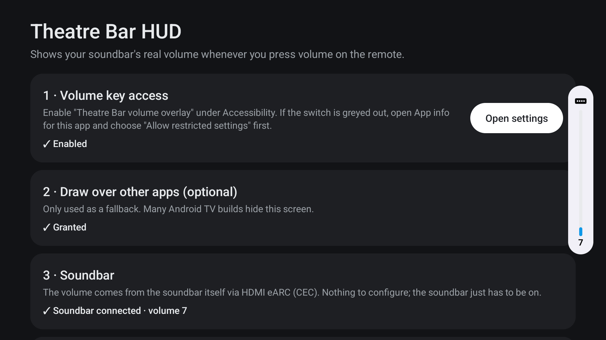
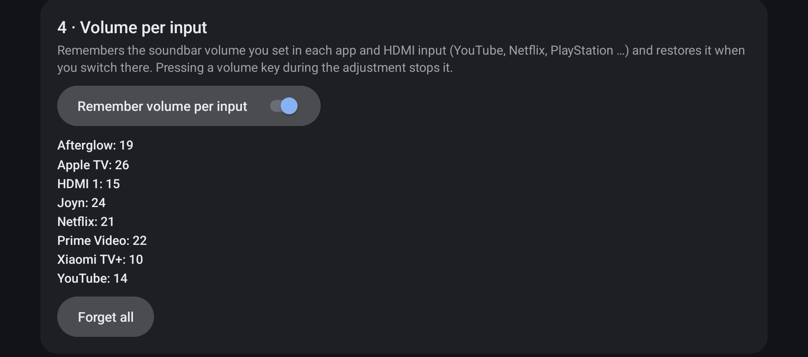
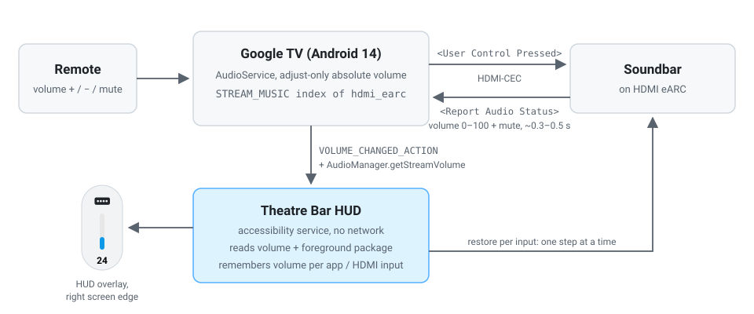

# Theatre Bar HUD

**See your soundbar's real volume on a Google TV that isn't made by the soundbar's maker.**

[](LICENSE)
[](#compatibility)
[](https://github.com/heynol/theatre-bar-hud/releases/latest)
[](https://github.com/heynol/theatre-bar-hud/actions/workflows/ci.yml)

<p align="center">
  
</p>

## The problem

A Sony soundbar on HDMI eARC only shows its volume on Sony's own TVs. On any other TV, pressing volume
on the remote changes the soundbar, but the screen shows nothing: no bar, no number, no mute indicator.

Theatre Bar HUD fills that gap. It shows the soundbar's real volume in the TV's own vertical volume HUD,
marked with a soundbar icon, over every app and HDMI input.

| Before | After |
| --- | --- |
| Volume key → soundbar changes, screen shows nothing | Volume key → HUD on the right edge with the soundbar's level, number and mute state |

<p align="center">
  
</p>

## Features

- **Real soundbar volume** from HDMI-CEC `<Report Audio Status>`, the same value the soundbar shows on
  its own display. Changes from the soundbar's remote or companion app show up too.
- **Native look.** On Xiaomi TVs the HUD is built from the TV's own TvSystemUI layout at runtime, so it
  matches the system HUD. Other TVs get an equivalent generic style.
- **Works over everything**: home screen, streaming apps and HDMI inputs such as a game console.
- **Volume per input.** Remembers the volume you settle on in each app and HDMI input and restores it
  when you switch there.
- **Optional Netflix button** mapping for Google TV remotes on Xiaomi TVs.
- **Tiny and private**: ~230 KB APK, no network permission, no analytics, nothing leaves the TV.

## Compatibility

**Tested**

- Xiaomi TV `MiTV-MOEU0`, Android TV 14, firmware `V816.0.26.3.19.002.ULBMIXM`
- Sony Bravia Theatre Bar 8 (HT-A8000) on HDMI eARC

**Should work**

- Android TV / Google TV devices with API 30+ whose audio system is on HDMI ARC/eARC and uses Android's
  *adjust-only absolute volume* (the TV forwards volume keys over CEC and mirrors the reported level).
  Without Xiaomi's TvSystemUI layout the HUD falls back to a generic style.
- Other CEC soundbars and AV receivers that answer `<Report Audio Status>`.

**Won't work**

- TV speakers (the TV's own HUD stays in charge, Theatre Bar HUD stays hidden).
- Optical (S/PDIF) or Bluetooth audio: no CEC, so the TV never learns the soundbar's volume.

> **Tested it on another TV or soundbar?** [Open a compatibility report](https://github.com/heynol/theatre-bar-hud/issues/new?template=compatibility_report.md),
> whether it worked or not. Reports are added to the table below.

| TV | Android | Soundbar / receiver | Connection | HUD | Volume per input | Reported by |
| --- | --- | --- | --- | --- | --- | --- |
| Xiaomi `MiTV-MOEU0` | 14 | Sony HT-A8000 | eARC | ✅ native style | ✅ | [@heynol](https://github.com/heynol) |

## Install

### Option A: Download the APK (with a computer)

1. Download `theatre-bar-hud-1.0.0.apk` from the [latest release](https://github.com/heynol/theatre-bar-hud/releases/latest).
   Optionally check it against the `.sha256` file next to it:

   ```bash
   shasum -a 256 -c theatre-bar-hud-1.0.0.apk.sha256
   ```

2. On the TV: *Settings → System → About* → click *Android TV OS build* 7 times. Then
   *Settings → System → Developer options* → enable *Wireless debugging* → *Pair device with pairing code*.
3. Pair and connect from your computer ([Android platform tools](https://developer.android.com/tools/releases/platform-tools)):

   ```bash
   adb pair <tv-ip>:<pairing-port> <pairing-code>
   ```

   ```bash
   adb connect <tv-ip>:<connect-port>
   ```

4. Install:

   ```bash
   adb install -r theatre-bar-hud-1.0.0.apk
   ```

5. Continue with [Setup](#setup).

Release APKs are signed with this certificate. Verify it with
`apksigner verify --print-certs theatre-bar-hud-1.0.0.apk`:

```
CN=Pascal Heynol
SHA-256: A0:BD:A1:33:7D:24:4E:53:D8:11:6A:2D:A6:A0:BA:26:AD:2B:90:57:C5:87:6E:07:AD:EB:BD:E1:00:94:B3:81
```

### Option B: Without a computer

1. Install a sideloading app such as **Downloader** from the Play Store, or copy the APK to a USB stick.
2. Allow it to install apps: *Settings → Privacy → Security & restrictions → Unknown sources* (on some TVs
   under *Settings → Apps*) → enable the app you install with (Downloader or your file manager).
3. Open the [releases page](https://github.com/heynol/theatre-bar-hud/releases/latest) in Downloader, or
   the APK on the USB stick, and install it.
4. Open *Settings → Apps → See all apps → Theatre Bar HUD*. On Android 13+ sideloaded apps are blocked from
   accessibility until you allow it: open the app's menu and choose **Allow restricted settings**.
5. Continue with [Setup](#setup).

### Option C: Build from source

Requires JDK 17 and the Android SDK (API 36).

```bash
git clone https://github.com/heynol/theatre-bar-hud.git
```

```bash
cd theatre-bar-hud && ./gradlew assembleRelease
```

```bash
adb install -r app/build/outputs/apk/release/app-release.apk
```

Without a signing key the release build is signed with your local debug key and Gradle prints a warning.
That is fine for your own TV, but it can't update an APK from the releases page (uninstall that first).
To sign with your own key, point `HEYNOL_SIGNING_PROPERTIES` at a properties file with `storeFile`,
`storePassword`, `keyAlias` and `keyPassword`.

## Setup

The HUD runs as an **accessibility service**. Turn it on once:

- **On the TV:** open *Theatre Bar HUD* from the apps row. The setup screen links to the accessibility
  settings, shows whether the soundbar is connected and has a *Preview overlay* button. In the accessibility
  settings, enable **Theatre Bar volume overlay**. If the switch is greyed out, see *Allow restricted settings*
  in [Option B](#option-b-without-a-computer).
- **Over adb:** this appends the service to the ones already enabled instead of replacing them:

  ```bash
  adb shell 'svc=dev.heynol.barhud/.service.VolumeKeyService; cur=$(settings get secure enabled_accessibility_services); case "$cur" in *"$svc"*) ;; null|"") settings put secure enabled_accessibility_services "$svc" ;; *) settings put secure enabled_accessibility_services "$cur:$svc" ;; esac'
  ```

<p align="center">
  
</p>

**Why an accessibility service?** It is the only way for a regular app to

1. draw an overlay *above HDMI inputs and video apps* without taking focus away from playback, and
2. know **which app or input is in front**, for the volume per input.

The service only receives *window state changes*, from which it reads the **package name**. It cannot read
window content (`canRetrieveWindowContent="false"`), and it reads nothing else besides the media volume.
Key filtering is only requested while the optional Netflix button mapping is on, and then only that button
is acted on.

The system binds the service at boot and after updates. Wireless debugging is only needed for installing
and can be switched off again.

## Usage

- **HUD:** press volume up, down or mute. The HUD appears on the right edge with the soundbar's level and
  hides after 3 seconds. On Xiaomi TVs it follows the soundbar's report about 0.3–0.5 s after the press.
- **Volume per input:** just use the TV. The volume you settle on in an app or HDMI input is remembered and
  restored 1.5 s after you switch back, one step at a time (the HUD counts along). Any volume change during
  that walk stops it and is remembered instead. The setup screen lists the stored values and lets you turn
  the feature off or forget everything.

  <p align="center">
    
    <br><sub>Switching to Netflix: the soundbar walks from 7 to the 21 remembered for Netflix. App content is black in screen recordings.</sub>
  </p>

  <p align="center">
    
  </p>

- **Netflix button (optional, off by default):** setup screen, section 5. Makes the Netflix button of
  Google TV remotes open Netflix on Xiaomi TVs, which otherwise ignore it.
  **Side effect on Xiaomi:** while it is on, a single "volume down" occasionally mutes the soundbar
  (see [Remote and Netflix button](#remote-and-netflix-button)).

## Privacy

- **No network.** The app has no `INTERNET` permission and cannot send anything anywhere.
- **No analytics, no accounts, no ads.**
- Permissions: the accessibility service binding, and `SYSTEM_ALERT_WINDOW` as an optional overlay fallback.
- Stored on the TV only: the remembered volume per input (package name or HDMI port → number) and the two
  switches. *Clear data* or uninstalling removes them.

## How it works

<p align="center">
  
</p>

1. **Volume source (no network).** With an eARC audio system Android 14 uses *adjust-only absolute volume*.
   Each volume key goes to the soundbar as CEC `<User Control Pressed>`. The soundbar answers with
   `<Report Audio Status>` (0–100 plus a mute bit), and Android stores that value as the media volume of the
   HDMI eARC device. [`TvVolumeSource`](app/src/main/java/dev/heynol/barhud/volume/TvVolumeSource.kt) reads it
   through `AudioManager` and listens for `VOLUME_CHANGED_ACTION`, so changes from the soundbar remote or its
   app show up as well.
2. **Timing.** On Xiaomi the HUD follows the reported value, ~0.3–0.5 s after a press: the volume keys never
   reach the accessibility key filter because Xiaomi's key handling consumes them first. Where the filter does
   get them, the first press shows "last volume ± 1" at once and the report corrects it. While keys are still
   arriving, reports are held back for 400 ms so the bar never jumps backwards.
3. **Soundbar only.** The HUD appears only while media audio is routed to HDMI ARC/eARC.
4. **Native look.** [`HudContent`](app/src/main/java/dev/heynol/barhud/hud/HudContent.kt) inflates TvSystemUI's
   own `mi_volume_vertical_dialog_layout` at runtime, with its themed pill background, spacing and text style.
   Nothing from that package is copied into this repository; it is looked up by resource name on the TV.
   Xiaomi's `ProgressView` is replaced by [`VerticalTrackView`](app/src/main/java/dev/heynol/barhud/hud/VerticalTrackView.kt)
   (track `#E7E7E7`, fill `#0E98E8`, muted `#33000000`), and the speaker icon by a soundbar glyph. If the layout
   is missing, an equivalent tree is built from [`HudStyle`](app/src/main/java/dev/heynol/barhud/hud/HudStyle.kt).
5. **Overlay.** A non-focusable, non-touchable accessibility overlay on the right edge, vertically centred,
   hidden after 3 s. The window is attached once and parked at alpha 0 when hidden. The compositor skips it,
   but the GPU pipeline stays warm, so showing it costs a single frame.

### Volume per input

- **Input detection:** [`ForegroundInputTracker`](app/src/main/java/dev/heynol/barhud/service/ForegroundInputTracker.kt)
  uses window state events (package name only). Launchable TV apps count as inputs (`app:com.netflix.ninja`).
  On Xiaomi all HDMI inputs run inside the LiveTV app, so there the port comes from the `TvSourcesStatus`
  global setting (`hdmi1|HDR10` → `hdmi:hdmi1`). Overlays such as quick settings or the assistant keep the
  current input. The home screen isn't an input, so nothing is learned or restored there.
- **Learning:** every volume the soundbar settles at while an input is in front is stored for that input,
  including changes made with the soundbar remote.
- **Restoring:** in adjust-only absolute volume mode Android ignores `setStreamVolume`, so
  [`VolumeController`](app/src/main/java/dev/heynol/barhud/service/VolumeController.kt) walks the soundbar to
  the target with `adjustStreamVolume`, one CEC step at a time, waiting for each `<Report Audio Status>`
  (~2–3 steps/s). The walk starts 1.5 s after the switch, so zapping through inputs changes nothing, and it is
  skipped while muted. Volume keys never reach the app on Xiaomi, so the walk watches the soundbar's reports:
  any value it didn't cause (a press in the other direction, an extra step, mute, a change during the 1.5 s
  wait) cancels it, and that volume is learned for the input. A press in the walk's own direction can't be
  told apart from a walk step, so it only shortens the walk.

### Remote and Netflix button

Google TV remotes (for example from a Google TV Streamer paired to the TV) send `BUTTON_4` for Netflix
(`Vendor_18d1_Product_9451.kl`). Xiaomi routes it to `mitv.service`'s `GlobalKeyReceiver`, which only launches
Netflix for the Xiaomi remote's `BUTTON_6`. With the switch on, the service requests accessibility key
filtering, consumes `BUTTON_4` and launches `com.netflix.ninja`.

Once any accessibility service filters keys, Android's `KeyboardInterceptor` runs the window policy's
`interceptKeyBeforeDispatching` for volume keys ahead of normal dispatch. Xiaomi's `MitvAudioService` counts
volume key events there and mutes on two "down" events within 750 ms, so a single press occasionally mutes
the soundbar. Filtering is therefore only switched on while this option is on. There is no stable way
around it: Xiaomi's key mapping is hard-coded, and reading the key from the system log (`READ_LOGS`) was
tried and proved unreliable.

## Troubleshooting

**The HUD doesn't appear**

- Open the app. If step 1 says *Not enabled*, enable the service again. *Clear data* and *Force stop* in App
  info both switch the accessibility service off.
- Step 3 must say *Soundbar connected*. If not, the TV plays through its own speakers or the soundbar isn't
  on HDMI eARC/ARC with CEC enabled (on the TV: *HDMI CEC*, *eARC* and *Audio output: HDMI ARC/eARC*).
- Press *Preview overlay*. If that shows the HUD but volume keys don't, the TV doesn't mirror the soundbar's
  volume. Run `adb shell setprop log.tag.TvVolumeSource DEBUG` and check `adb logcat -s TvVolumeSource`,
  then [open a compatibility report](https://github.com/heynol/theatre-bar-hud/issues/new?template=compatibility_report.md).

**Pressing "volume down" twice quickly mutes the soundbar**

That is Xiaomi's `MitvAudioService`, which mutes on two "down" presses within 750 ms; it happens without this
app too. With the Netflix button mapping on, a single press can occasionally count twice. Turn the mapping
off if that bothers you.

**The volume jumps when I switch apps or inputs**

That is volume per input restoring what you last used there. Press volume during the walk to stop it (the
new value is remembered), turn *Remember volume per input* off, or *Forget all*.

## Uninstall

*Settings → Apps → Theatre Bar HUD → Uninstall*, or:

```bash
adb uninstall dev.heynol.barhud
```

Android removes the accessibility service entry and all stored data with the app.

## Development

```bash
./gradlew testDebugUnitTest assembleDebug
```

**Logging**

```bash
adb logcat -s VolumeController ForegroundInputTracker HudContent HudOverlay VolumeKeyService DemoReceiver
```

`adb shell setprop log.tag.TvVolumeSource DEBUG` additionally logs the detected media output on every event.

**Demo trigger.** Plays 18 → 24 in steps, mute, unmute on the real HUD without changing the volume, for
screenshots and screen recordings. It is protected by the `DUMP` permission, so only the adb shell can send
it, and the accessibility service has to be on:

```bash
adb shell am broadcast -a dev.heynol.barhud.DEMO -n dev.heynol.barhud/.service.DemoReceiver
```

Optional extras: `--ei from 30 --ei to 22 --el step_ms 250`.

**Tuning.** The native HUD pops in and out without animation. Set `FADE_IN_MS` / `FADE_OUT_MS` in
[`HudStyle`](app/src/main/java/dev/heynol/barhud/hud/HudStyle.kt) to `0` for an exact match.

**Project structure**

```
app/src/main/java/dev/heynol/barhud/
├── hud/        HudOverlay (window), HudContent (native or fallback views), VerticalTrackView, HudStyle, HudDemo
├── service/    VolumeKeyService (accessibility service), VolumeController, ForegroundInputTracker,
│               RemoteSettings, DemoReceiver
├── setup/      SetupActivity (D-pad friendly status and settings screen)
└── volume/     TvVolumeSource (AudioManager + CEC-mirrored volume), InputVolumeMemory, VolumeState
```

**Release builds** are signed with the key from `$HEYNOL_SIGNING_PROPERTIES` or
`~/Keystores/heynol-sideload.properties`, and fall back to the debug key with a warning when neither exists.

## Known limitations

- **Holding a volume key** moves the soundbar only a couple of steps, and **two quick "down" presses mute**.
  Both are Xiaomi's `MitvAudioService` key handling, with no setting for either. Repeated presses work normally.
- On Xiaomi the HUD appears with the soundbar's report, ~0.3–0.5 s after the press, not instantly.
- `adb shell input keyevent` bypasses accessibility filters. Injected keys still change the volume and the HUD
  follows the reported value, but without the instant prediction.
- Volume per input knows HDMI ports only on Xiaomi (via the LiveTV app). On other TVs each TV input app counts
  as one input.
- The native look needs Xiaomi's TvSystemUI layout. Other TVs get the generic style.

## Contributing

Issues and pull requests are welcome. **Compatibility reports are the most useful contribution**: which TV,
firmware and soundbar you tried, and what happened. Use the
[compatibility report template](https://github.com/heynol/theatre-bar-hud/issues/new?template=compatibility_report.md).

For code changes, run `./gradlew testDebugUnitTest assembleDebug` and describe how you tested on a TV.

## License

[MIT](LICENSE) © 2026 Pascal Heynol

**Disclaimer:** Not affiliated with, endorsed by or sponsored by Xiaomi or Sony. All trademarks belong to
their respective owners. Xiaomi, Sony, Bravia, HT-A8000, Google TV, Android TV and Netflix are mentioned only
to describe compatibility.
